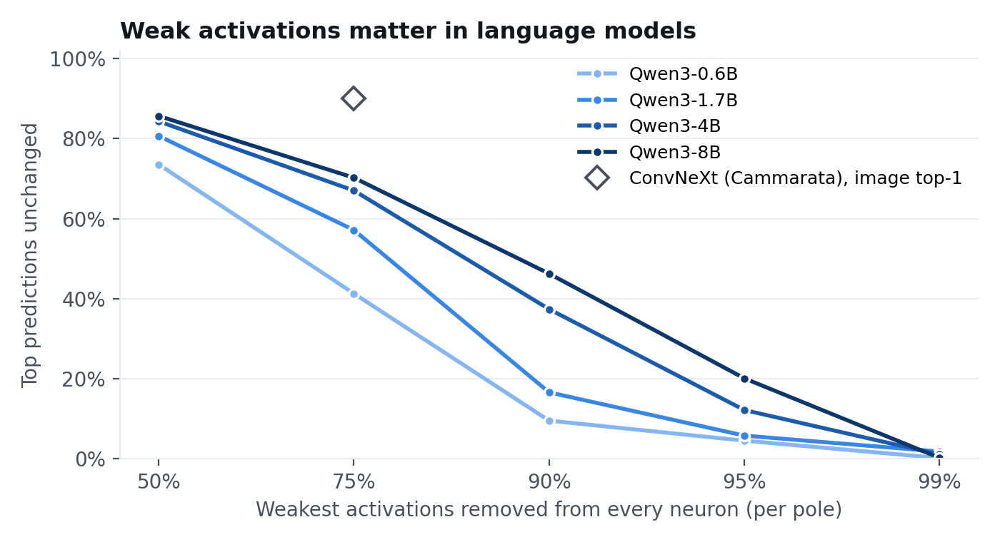
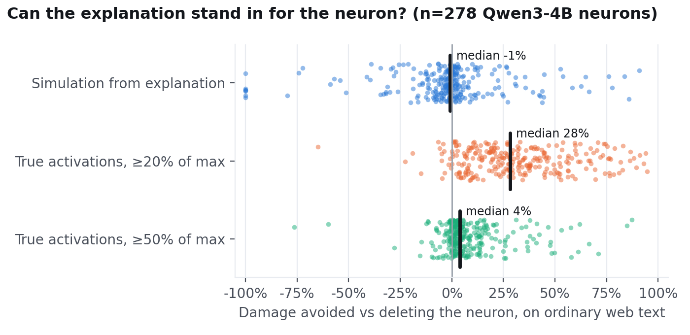
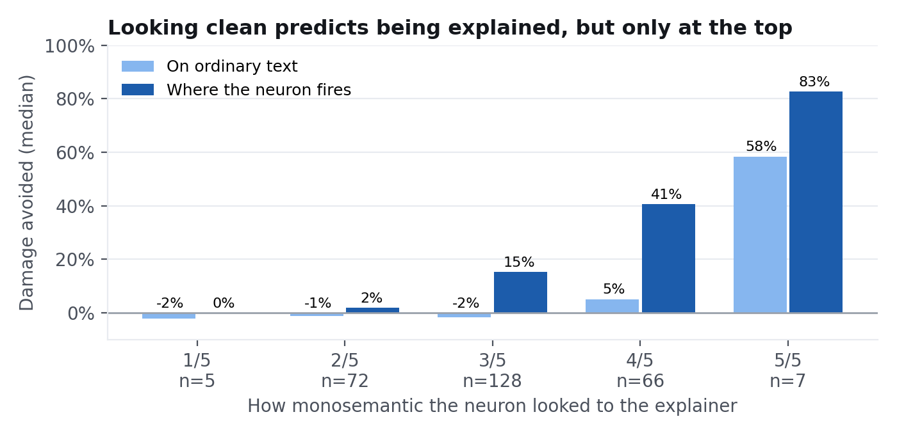

# Neural networks are kinda clean

Two recent posts disagree about whether you can read a neural network one neuron at a time.

- **Nick Cammarata, [Neural networks are already clean](https://already-clean.goodfire.com/) (Goodfire).** If you look carefully, most neurons have one main job. Polysemanticity was mostly a tooling and explanation problem. Weak activations "usually don't matter": in ConvNeXt, removing each neuron's weakest 75% of activations only moves accuracy from 72% to 71%.
- **Leo Gao, [Neural networks are not already clean](https://www.lesswrong.com/posts/Dkh7pXKjoNWkkxQDz/neural-networks-are-not-already-clean) (LessWrong).** Clean-looking top examples can fool you in two ways:
  - a neuron can fire on only part of what the explanation describes (precision isn't recall);
  - the weak activations can matter.

  His proposed test is to replace the neuron with a simulation built from its explanation, then check the model doesn't break, using downstream KL on a big dataset.

I ran Leo's test on Qwen3-4B, the same family as Nick's Qwen3-32B audit. I also ran the weak-activation ablation, since that's where Leo said his results and Nick's split.

## Short version

My takeaway is that neural nets are *kinda* clean, which is somewhere in between the two posts.

- **A few neurons really are clean.** About 4% of the ones I sampled are fully explained by one sentence. You can swap the neuron for a simulation of that sentence and the model barely notices. Nick is right that these exist and that they're not hard to find.
- **For most neurons, the clean story is true but not enough.** The explanation correctly says when the neuron fires *strongly*, but most of what the model uses the neuron for is small activations the explanation doesn't cover. Replacing the neuron with its explanation is about as bad as deleting it, and sometimes worse.
- **Weak activations matter a lot more in these language models than in Nick's ConvNeXt.** This is a different task and a different metric, so it's not a direct contradiction. But "just ignore the bottom 75%" clearly doesn't carry over.

## What I found

**1. Some neurons are clean.** 11 of 278 neurons pass 50% damage avoided (the metric is explained under "How it works" below). They're almost all single-word detectors in the first layers or the last one: `info`, `site`, `afford`, `cert`, `rental`, the ` un` prefix. The explainer's "looks monosemantic" rating does predict this: the five neurons rated 5/5 score a median 83% where they fire.

**2. Weak activations matter in language models.** I zeroed each neuron's weakest 75% of activations, which is Nick's ConvNeXt setting. That changes the top next-token prediction on **59% → 43% → 33% → 30%** of tokens across Qwen3 0.6B → 8B.
- **ConvNeXt comparison:** the point on the plot is about 10% from Nick's setup.
- **Not apples to apples:** that's image top-1 vs next-token prediction over 151k tokens, so read it as "much more sensitive," not as a precise comparison.
- **Keeping only each neuron's strong half** breaks every model size.



**3. For most neurons, the explanation doesn't work as a stand-in.**
- **Simulation from the explanation:** a median of **−1%** damage avoided on ordinary text, so no better than deleting the neuron. On windows where the neuron fires, it gets 15%.
- **Perfect knowledge of the strong firings:** keeping the neuron's *real* values wherever |a| ≥ 20% of max still recovers only **28%** on ordinary text. Even a perfect explanation of the big activations wouldn't get you far.
- **Stronger simulator:** using Opus instead of Sonnet didn't help.





## Three neurons that show the pattern

"Ordinary text" means random web text, weighted by how often each situation actually comes up. "Where it fires" means only held-out windows where the neuron is active, which is closest to what looking at top examples measures. The last column keeps the neuron's real values wherever it's ≥20% of max and zeroes the rest.

| Neuron | Rated clean | Ordinary text | Where it fires | True strong firings only |
|---|---|---|---|---|
| `info` (layer 0) | 5/5 | **86%** | 96% | 88% |
| `PCR` acronyms (layer 0) | 4/5 | **−57%** | 92% | 14% |
| Insurance/eligibility (layer 32) | 2/5 | **−1%** | 4% | 19% |

**`info` is clean all the way down.** It fires on the token "info" ("more info", "phpinfo") and basically nothing else. The simulation is as good as any oracle I tried. A layer-0 neuron mostly sees the raw token, so "fires on *info*" really is the whole story.

**`PCR` looks clean but isn't.** It fires on uppercase acronyms like PCR, PCB, CPR and DNA. Where it fires, the simulation is nearly perfect: 92%, with 0.94 correlation, so a correlation-style score would call it solved. On ordinary text, it's worse than deleting the neuron. Two things go wrong:
- **Background activity:** even the real strong firings only recover 14%, so most of its everyday effect is small activations nobody described. That's Leo's magnitude point.
- **Too-broad guess:** a negative score means the simulation is putting wrong values into the model, not just missing some. My best guess is that "acronyms starting with C/P/D" is broader than what the neuron actually responds to. That's Leo's precision-vs-recall point. I inferred this from the score and haven't checked it token by token.

**The insurance/eligibility neuron is the typical deep-layer neuron.** The explanation is a grab bag: connector words inside category phrases on one side, Medicare/Medicaid names on the other. The simulation does about as well as deleting. Interestingly, true values ≥20% of max recover 19% but ≥50% recovers 0%. So its effect is in the mid-sized activations, not the peaks top examples show you.

So a clean rating is necessary but not sufficient, and layer depth matters most: the layer-0 token detectors are explainable, while deeper neurons mostly aren't from top examples alone.

## How it works

1. **Neurons:** 278 random MLP neurons of Qwen3-4B, about 28 from each of layers 0, 4, …, 32 and 35. A neuron here is one coordinate of the SwiGLU hidden state (the input to `down_proj`), so it has a positive and a negative side.
2. **Activations:** recorded on 2.1M tokens of FineWeb in 64-token windows.
3. **Explanations (Claude Opus):** the explainer sees about 60 example windows per neuron (top, mid and weak examples on both sides, plus random ones) and writes an explanation with a scoring rubric, Cammarata-style. It also rates how monosemantic the neuron looks, from 1 to 5.
4. **Simulation (Claude Sonnet):** the simulator sees *only the explanation* and predicts every token's activation on 160 windows. These are 128 random windows plus 32 held-out windows where the neuron fires, shuffled together. None of them were shown to the explainer.
5. **Scoring:** put the substitute values into the neuron and measure KL(clean ‖ patched). Windows are reweighted to how often they occur in real text. **Damage avoided = 1 − KL(substitute) / KL(mean-ablation).** 100% is a perfect stand-in, 0% is no better than deleting the neuron, and negative is worse than deleting it.

| Substitution | What replaces the neuron |
|---|---|
| `mean` | its average activation (the baseline) |
| `strong20` / `strong50` | the true activation where \|a\| ≥ 20% / 50% of max, else 0. An oracle for "explain the strong firings perfectly" |
| `sim_cal` | simulator output with a per-neuron linear calibration, cross-fit on held-out halves |

The weak-activation ablation (`src/e1_weak_ablation.py`) zeroes activations below a per-neuron, per-sign quantile, for every neuron in every layer at once. It then measures KL, loss, top-1 agreement and accuracy on held-out FineWeb.

## Caveats

- **Automated explanations.** About 60 examples per neuron, not the long hand investigation in Nick's audit. Better explanations could do better, but the oracle rows cap how much you can get from the strong firings alone.
- **Small scale.** One model for the simulation test, 278 neurons, 64-token windows.
- **ConvNeXt isn't a clean comparison.** It's a different task (image classification vs next-token prediction) and a different metric. The language-model numbers stand on their own; the ConvNeXt point is there for scale.
- **Tiny per-neuron effects.** The KL from patching one neuron is about 1e-6 to 1e-5 nats. Everything runs in fp32 with TF32 off, and every score is relative to the same neuron's mean ablation. I haven't run a separate numerical-noise control, though, so trust the overall pattern more than any single neuron's exact percentage.
- **A bug I caught along the way.** The first simulator prompt marked tokens inline (`⟦i⟧token`), and the model often attached each index to the previous token, which shifted predictions one token late. I redid the run with one token per line, and `src/align_check.py` checks that alignment peaks at shift 0. The buggy run isn't used anywhere.

## Repo

```
src/prepare_data.py      FineWeb -> 64-token windows
src/collect.py           sample 280 neurons, record activations
src/e1_weak_ablation.py  weak-activation ablation (any Qwen3 size)
src/evalsets.py          per-neuron stratified eval sets
src/explain.py           explanations (Batch API)
src/simulate.py          simulations (Batch API)
src/score.py             KL substitution scoring
src/align_check.py       simulator token-alignment check
src/analyze.py           -> results/summary.json
src/make_figs.py         -> figs/*.png
writeup/index.html       interactive version of this write-up
results/                 explanations, scores, eval sets, summaries
```

Runs on one H100 (80GB). Install with `pip install -r requirements.txt`. The whole thing took about 3 GPU-hours and $70 of API calls.
```
python src/prepare_data.py && python src/collect.py
python src/e1_weak_ablation.py Qwen/Qwen3-4B
python src/evalsets.py
python src/explain.py --batch && python src/simulate.py --batch
python src/align_check.py && python src/score.py && python src/corr_fix.py
python src/analyze.py && python src/make_figs.py
```
Environment variables: `DATA_DIR`, `OUT_DIR`, `ANTHROPIC_API_KEY`, and `CLAUDE_BUDGET_USD` (a hard spend stop, default 120).
